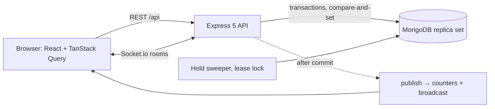

# SeatBook

Reserved-seat ticketing with a live seat map: seat holds that are atomic and expire on time, an idempotent checkout, signed single-use tickets, a phone check-in scanner, and organizer dashboards.

**Live demo:** https://seatbook-sajidur.onrender.com · demo logins on the login page, one per role. The free host sleeps when idle: give the first request about 30 seconds.

## The hard problems, and the tests that prove them

| Problem                               | Approach                                                                                       | Proof                                                              |
| ------------------------------------- | ---------------------------------------------------------------------------------------------- | ------------------------------------------------------------------ |
| Two people, one seat                  | One conditional `findOneAndUpdate` per claim (compare-and-set); unique indexes as the backstop | 50 concurrent claims → 1 winner (`holds.race.test.ts`)             |
| Holds that expire on time             | Lazy expiry in every query, plus a leased sweeper every 5 s; TTL only for cleanup              | Fake-clock suite (`expiry.test.ts`)                                |
| A live map that never lies            | Broadcast after commit, per-seat versions, resync on reconnect                                 | Socket tests + Playwright two-browser test                         |
| Pay without losing money or seats     | Idempotency key, lock + payment window, one transaction, refund saga                           | 20 concurrent checkouts → 1 booking, 1 charge (`checkout.test.ts`) |
| Tickets that can't be faked or reused | HMAC codes never stored, constant-time verify, single-use compare-and-set                      | 2 gates at once → 1 check-in (`checkin.test.ts`)                   |
| Organizers can't see each other       | Scoped finders, 404 not 403, routes discovered by tests                                        | `cross-owner.test.ts`, `rbac.test.ts`, `route-guards.test.ts`      |
| Numbers you can trust                 | `$facet`, `$dateToString` in the event's time zone, `$setWindowFields`                         | Hand-calculated fixture (`dashboard.test.ts`)                      |
| And under load?                       | 100 buyers × 2 minutes on one map, then an invariant checker                                   | `npm run load:holds && npm run check:invariants` → 0               |

Measured on a laptop (Windows, local MongoDB 7/8):

- **Load test**, 100 buyers for 2 minutes: 1,040 hold attempts (460 won, 580 lost a race), 122 bookings, 34 abandoned carts, **0 server errors, 0 invariant violations** right after, and again once the abandoned holds expired.
- **Hold latency**, measured by the server: p50 26 ms / p95 45 ms with 20 buyers. With 100 buyers on one machine the laptop saturates (see _Known limitations_).
- **Dashboard**, 5,000 tickets and 20,000 scans: p50 43 ms / p95 62 ms (target < 500 ms, `npm run bench:dashboard -w @seatbook/api`).

## Architecture



- **Browser:** a React 19 single-page app. Server state lives in TanStack Query; socket messages patch the same cache, so a seat changes colour without a refetch.
- **API:** Express 5 with Zod validation on every input. Each route declares its permission (`authorize`) or `access('public' | 'self')`, and a test walks the router to prove it.
- **MongoDB:** a replica set, because checkout, publish and approvals use transactions. Seat claims and check-ins don't need one: a single conditional update is atomic.
- **After commit:** services call `publish()` only after the write commits. It bumps the display counters, then broadcasts to the event, staff and user rooms. A message never announces something that could still roll back.
- **Sweeper:** frees expired holds every 5 s under a lease lock, so only one instance sweeps. Correctness never waits for it: every read applies lazy expiry.

The full design is in the `seatbook-docs` folder: `1-planning/project-overview.md` (§10 architecture), `2-design/` (data model, schema, queries, database), and the 20-day build guide.

## Run locally (3 commands)

You need Node 26 and Docker. Copy `apps/api/.env.example` to `apps/api/.env` and fill in the two secrets and `SEED_DEMO_PASSWORD`.

```bash
npm install
npm run db:up && npm run seed      # MongoDB on port 27018, then the demo (about 2 minutes)
npm run dev                        # http://localhost:5173 · log in as organizer@demo.seatbook.dev
```

Demo accounts (all with your `SEED_DEMO_PASSWORD`): `organizer@`, `attendee@`, `attendee2@`, `admin@` and `applicant@demo.seatbook.dev`. To show them as buttons on the login page, build with `VITE_DEMO_ACCOUNTS=true` and `VITE_DEMO_PASSWORD` (`apps/web/.env.example`).

## Tests

| Command                                           | What                                                                                          |
| ------------------------------------------------- | --------------------------------------------------------------------------------------------- |
| `npm test`                                        | Unit, integration, race and socket tests on an in-memory MongoDB                              |
| `npx playwright test`                             | End to end: two browsers on one map; build → buy → check in with the dashboard updating live  |
| `npm run load:holds` + `npm run check:invariants` | 100 buyers × 2 minutes against a local server with `RATE_LIMITS=off`, then the six invariants |
| `npm audit --omit=dev --audit-level=high`         | Known vulnerabilities in what runs in production                                              |

CI (`.github/workflows/ci.yml`) runs all of it.

## Security (OWASP Top 10, 2021)

|                             | SeatBook's answer                                                                                  | Evidence                                                      |
| --------------------------- | -------------------------------------------------------------------------------------------------- | ------------------------------------------------------------- |
| A01 Broken access control   | Role read from the database per request, scoped finders, 404 not 403, every route declares a guard | `cross-owner.test.ts`, `rbac.test.ts`, `route-guards.test.ts` |
| A02 Cryptographic failures  | bcrypt, hashed refresh and reset tokens, HMAC ticket codes, `timingSafeEqual`                      | `ticketCodes.test.ts`, AC-TKT-01 in `checkout.test.ts`        |
| A03 Injection               | Zod everywhere, `$`/`.` keys rejected, `escapeRegex`, no `$where`                                  | `backbone.test.ts`, `attendees.test.ts`                       |
| A04 Insecure design         | Compare-and-set writes, transactions, unique indexes, race suites                                  | `holds.race.test.ts`, `checkout.test.ts`, `checkin.test.ts`   |
| A05 Misconfiguration        | Helmet with a strict CSP, HSTS, Permissions-Policy, generic 500s                                   | `backbone.test.ts` (headers)                                  |
| A06 Vulnerable components   | `npm audit` in CI, build-only tools in `devDependencies`                                           | the `audit` CI job                                            |
| A07 Authentication failures | Rate limits per IP, email and user; refresh rotation with reuse detection                          | `auth.test.ts`                                                |
| A08 Integrity failures      | Lockfile + `npm ci`; prices and totals only from the server                                        | AC-PAY tests                                                  |
| A09 Logging failures        | Structured logs, domain events, secrets redacted                                                   | `redaction.test.ts`                                           |
| A10 SSRF                    | The server never fetches a user-supplied URL (`website` is stored, never fetched)                  | code review                                                   |

## Decisions & trade-offs

- Transactions only where several documents must change together (publish, booking, approval); everything else is one conditional update.
- REST for every write, sockets only to fan out what already happened.
- Mock payments, but a real saga: charge outside the transaction, refund if the commit fails.
- Display counters on the event for lists, aggregations for dashboards, and `repair:counters` to reconcile the two.
- One region, one instance; the socket rooms would move to the Redis adapter to scale out.

## Known limitations

- **Mock payment provider.** A crash between charge and commit needs reconciliation against a real provider's records.
- **Password hashing blocks the event loop.** `bcryptjs` is pure JavaScript. A burst of 100 logins on one instance delays every other request by seconds (seen in the load test). Fix: native `bcrypt` or `argon2`, which hash on libuv threads.
- **The free host sleeps.** Lazy expiry keeps every hold decision correct while it does, and the first request wakes it.
- **No offline check-in.** The scanner needs a connection.
- **Cancellations and refunds by attendees** are planned for v1.1.

## At Ticketmaster scale I would…

Add a virtual waiting room in front of on-sales · keep holds in Redis with Lua scripts · shard seats by `eventId` · coalesce broadcasts per event and tick · use a real payment provider with webhooks · give scanners an offline mode with a signed allow-list.
